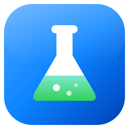

<div align="center">



# LabKit · Research Toolbox

**A local-first research workbench** — lab notebook, 20 research tools, pathology whole-slide browsing & ROI cropping (SDPC / SVS / NDPI / MRXS / CZI…), qPCR ΔΔCt analysis.

[](https://github.com/Funvvell/labkit/releases)
[](LICENSE)
[](#-quick-start)
[](https://funvvell.github.io/labkit/)

[Quick start](#-quick-start) · [Features](#-features) · [Shortcuts](#-shortcuts) · [Development](#-development) · [中文](README.md)

</div>

> **Disclaimer**: all computations and image outputs are **for research use only, not for clinical diagnostic use**.
> **Privacy**: everything runs locally. No telemetry, no accounts, no uploads — your notebook lives on your own machine.
> The repository contains no real study, specimen, or slide data; the first-run sample data is entirely fictional.

---

## ✨ Features

### Workbench (research notebook)

- Eleven record types: tasks, projects, experiments, literature, instruments, reagents, bookings, budget, quick notes, reminders — board + table views
- **Editable dashboard**: 16 widgets, each declaring multiple size tiers (mini summary / small compact / medium standard / large full). Free-form gridstack grid: drag to place, drag the bottom-right corner to resize (snaps to the widget's declared tiers); ⇔⇕ quick cycle, ⚙ exact coordinates, arrow keys to move / Shift+arrows to resize. Layout v2 persisted with the notebook; legacy layouts migrate in order with sizes preserved
- Focus timer with 7-day trends and completion reports
- **Notification center**: task deadlines, reagent expiry, instrument calibration due, export completion
- Disk-backed notebook at `~/.liver_portal_crop/labkit_db.json` with atomic writes, rolling backups and corruption self-healing; browser mode falls back to localStorage

### Tool library (20 tools / workspaces)

| Group | Tools |
| --- | --- |
| Statistics & data | 2×2 table analysis (OpenEpi) · sample size & power (OpenEpi) · hypothesis tests (t/χ²/Fisher/Mann-Whitney/Wilcoxon/variance/correlation) · Table 1 baseline · randomization & blinding · data cleaning & crosstabs · APA-7 report strings |
| Lab calculations | bench calculator (dilution/centrifugation/plating/MOI) · primer workbench (nearest-neighbor Tm) · **qPCR workspace** (ΔΔCt/Pfaffl/geNorm) · plate layout editor · protocol timer · experiment record → Markdown · reagent/inventory ledger |
| Writing & figures | publication plotter (300/600 dpi) · figure assembler · batch image processing (Rust, parallel) · **image cropping workspace** (SDPC / SVS / NDPI / MRXS WSI + ROI + TIFF/PNG/JPEG) · reporting checklists (PRISMA/STROBE/CONSORT/MIQE) · table format converter |

Every tool shares one chrome: **load example / reset / help & provenance drawer / export bar**. Inputs and configs **persist automatically** across page switches and restarts. **Cross-tool data flow**: cleaning → tests / plotter / Table 1; test results → APA strings (reloadable across restarts).

**Toolbox personalisation** (patterns from VS Code's Activity Bar and Dashy's section config):

- "Arrange" on the tool library page opens a draft mode — create / rename / recolour / re-icon / delete / reorder groups, drag tools across groups, reorder within a group, hide tools. Nothing is written until you press Save; `Esc` restores the previous state
- Hidden tools disappear from the sidebar and the library but **stay searchable in Ctrl+K with a "hidden" badge** (VS Code's `View: Open View` behaviour — hidden is not unreachable)
- Groups and ordering are **shared by** the library page, the sidebar categories and Ctrl+K. Only your diffs are stored (an overlay), so installing extensions or upgrading LabKit never scrambles your layout
- Keyboard equivalents: `Alt+←/→` moves between groups, `Alt+↑/↓` reorders within one

### Interaction (patterns borrowed from IT-Tools / DevToys / Rubick / Obsidian Bookmarks)

- **Ctrl+K command palette** over tools, pages and global actions, with pinyin-initial fuzzy matching
- **Lean sidebar + custom pins**: home / tool library / settings stay resident; tasks, projects, experiments, literature, lab resources, reports and focus live behind a single **Workbench ▾** entry on the dashboard. Pin any frequent entry to the sidebar (header ☆ / menu ☆ / tool star / Alt+F), drag to reorder, right-click to rename (same pattern as Obsidian Bookmarks / Trigger.dev Favorites)
- **Never stranded**: even with every home card removed, the Workbench ▾ menu, Ctrl+K and hash deep links still reach every page
- **All tools in the main window, a window only for a specific tool**: the sidebar entry, the dashboard "Manage tools / Tool library" links and `#/toolhub` deep links render the **tool library page inside the main window** (sidebar stays, no tab bar, no separate window); on desktop the **tool window** is created only when you open **a specific tool/workspace**, and initially contains only that tool; opening other tools from the main window afterwards adds **new tabs to the same window** (Tauri label `tools`), following the VS Code / Obsidian / JupyterLab Lumino tab model: one tab per tool, reopening focuses the existing tab and keeps its inputs and scroll position; **inside the tool window the library is still the base page after closing all tabs, not a tab** — the tab bar appears only after a tool/workspace is opened, and closing the last tool or using "Close all" returns to the library without closing the window; tabs can be drag-reordered, closed with middle-click or ✕, bulk-closed from the context menu, cycled with `Ctrl+Tab`, jumped to with `Ctrl+1…9`. The tab set is saved with the notebook and restored on restart; legacy `lib:toolhub` entries are discarded. The card ↗ / Ctrl/⌘+click / middle-click still detaches a single tool into its own window (label `tool-<id>`). Closing the main window exits the app: a `flush-now` broadcast collects save acknowledgements from every window first; on failure/timeout a dialog lets you force-quit or cancel. The notebook syncs across windows with **merge writes + event broadcast** — disjoint keys never clobber each other (same-key concurrent edits: last write wins)
- **Browser demo** has no multi-window: tools switch as tabs inside the same page; the library stays the base page and closing the last tool returns to it without ending the session
- **Hash deep links** (`#/tool/tests`), refresh-restore, back/forward
- Pins & recents, global shortcut registry with `?` help overlay
- **Dark mode** (light / dark / system); charts and crop canvas stay paper-white for journal submission
- First-run welcome: start blank or load sample data; customizable display name
- **Zotero integration**: read-only sync from local Zotero 7+ (items / collections / saved searches), source filtering and one-click import in the literature page; Zotero 10+ can optionally mirror reading status as tags after authorization (the local notebook stays authoritative); optional Better BibTeX probing
- **Extensions: tool extensions and widget extensions installed separately**: after HACS `category` and Directus extension `type` — one package is exactly one kind, and a kind mismatch is rejected *before* download. Tool extensions are browsed from **Tool library → "Get more tools"**, widget extensions from **Home → "＋ Card" → "Get cards"**; install / update / rollback / uninstall live in **Extensions** in the sidebar. Two indexes (`tools.json` / `widgets.json`), off by default, never auto-updates; tools and widgets share public registries with `x-<pluginId>-` prefix isolation — see [`docs/PLUGIN_DEV.md`](docs/PLUGIN_DEV.md)
- The design system no longer ships inside the app — see [`docs/DESIGN_SYSTEM.md`](docs/DESIGN_SYSTEM.md) (visual contract for new tools / extensions)

### Pathology workspace

- Unified WSI engine built on pure-Rust [`wsi-rs`](https://crates.io/crates/wsi-rs) (MIT/Apache-2.0), **no OpenSlide DLL required**
- Whole-slide pyramid browsing (LRU tile cache, navigator thumbnail, wheel level switching) for 120,000×80,000+ px slides
- Formats: **SDPC** (vendor DLL), Aperio `.svs`, Hamamatsu `.ndpi` / `.vms` / `.vmu`, 3DHISTECH `.mrxs`, Leica `.scn`, Ventana `.bif`, ARGOS `.avs`, Zeiss `.czi` / `.zvi`, Olympus `.vsi` (with `.ets` companions), DICOM WSI `.dcm` (or a folder), JPEG 2000 `.j2k` / `.j2c`, OME-TIFF and plain `.tif` / `.tiff`
- Metadata strip shows format / vendor / dimensions / mpp / objective power / pyramid levels, plus label and macro thumbnails
- ROI selection, tissue-detection assist, full-resolution batch export to **TIFF / PNG / JPEG** (DPI derived from mpp; JPEG quality selectable)
- Plain images (png/jpg/tif) need **no** extra component
- **SDPC works out of the box**: the first `.sdpc` open downloads the official `sdpc-for-python` wheel from PyPI (~62 MB, SHA-256 verified) and extracts only `WINDOWS/dll` into the user cache — **no Python or pip**, offline afterwards

## 🚀 Quick start

### 1. Installer (recommended)

Download `LabKit_*.exe` (NSIS) or `LabKit-portable-win-x64.zip` from [Releases](https://github.com/Funvvell/labkit/releases).

**SDPC decoder (download-on-demand)**: for licensing reasons the installer does **not** bundle the vendor's closed-source `DecodeSdpcDll.dll`. On the first `.sdpc` open the app downloads the official `sdpc-for-python` wheel from PyPI, verifies SHA-256 and extracts it to `%USERPROFILE%\.liver_portal_crop\decoders\sdpc`; no Python or pip needed. Failures show progress and a retry button on the crop page. For fully offline deployment, set `SDPC_DLL_DIR` or place `sdpc\WINDOWS\dll` next to the executable.

### 2. Web demo (zero install)

<https://funvvell.github.io/labkit/> — browser fallback mode: notebook in localStorage, all statistics/plotting/writing tools fully functional; SDPC decoding and disk backups require the desktop app.

### 3. From source

Requires **Rust 1.99+** (`rust-toolchain.toml` pins stable).

```bash
git clone https://github.com/Funvvell/labkit.git
cd labkit/rust
cargo install tauri-cli --locked   # first time only
cargo tauri dev
cargo tauri build
```

The frontend is **zero-build**: plain HTML/CSS/JS (classic scripts, ordered loading). Opening `frontend/index.html` in a browser works out of the box — no Node/Vite required.

## ⌨️ Shortcuts

| Key | Action |
| --- | --- |
| `Ctrl+K` | command palette (tools / pages / actions) |
| `Ctrl+,` | settings |
| `Alt+←` / `Alt+→` | back / forward |
| `Ctrl+Tab` / `Ctrl+Shift+Tab` | tool window: next / previous tab |
| `Ctrl+1…9` | tool window: jump to tab N |
| `Ctrl+W` | tool window: close the current tool tab; closing the last tool returns to the library without closing the window |
| `Ctrl+Shift+T` | reopen the most recently closed tool tab |
| `?` | shortcut help overlay |
| `Esc` | close panels / drawers |

## 🔒 Data & privacy

- Notebook: `~/.liver_portal_crop/labkit_db.json` (path / backups / import / export / reset in Settings)
- Tool input snapshots, pinned entries, recents, theme and display name persist with the notebook
- **No telemetry, no network calls** except DOI links you open and the optional InvenTree API integration
- Web demo data stays in your browser's localStorage

## 🧱 Architecture

```
frontend/            zero-build UI (index.html shell + css/ + js/ modules + tools/ + vendor/)
rust/                Tauri 2 + Rust: unified WSI reading (wsi-rs + SDPC FFI), TIFF/PNG/JPEG export, qPCR parsing, disk notebook, 220 tests
tests/js/            node:test parity tests (vs OpenEpi/scipy/tableone) + shell unit tests
rust/tests/          IPC naming-contract tests
```

## 🛠️ Development

```bash
cd rust && cargo test                 # Rust suite
node --test tests/js/*.test.mjs       # frontend parity / shell tests (Node 18+)
```

Adding a tool takes three steps (registry entry + script + parity test) — see [CONTRIBUTING.md](CONTRIBUTING.md).
Interaction patterns reference [IT-Tools](https://github.com/CorentinTh/it-tools), [DevToys](https://github.com/DevToys-app/DevToys), [Rubick](https://github.com/rubickCenter/rubick) (ideas only, no code copied); the pathology workspace uses [QuPath](https://github.com/qupath/qupath) as its domain baseline.

## 📄 License & attribution

- This project: [MIT](LICENSE)
- Third-party attributions: [NOTICE.md](NOTICE.md) and [frontend/vendor/LICENSES.md](frontend/vendor/LICENSES.md) (OpenEpi MIT, stdlib-js Apache-2.0, SciPy/Biopython BSD-3, Plotly/fabric MIT, …)
- PRISMA 2020 checklist CC-BY 4.0; the SDPC decoder DLL is vendor-proprietary and **not redistributed** in this repository or its installers
- Community: [Contributing](CONTRIBUTING.md) · [Security](SECURITY.md) · [Code of Conduct](CODE_OF_CONDUCT.md) · [Changelog](CHANGELOG.md)

> **Research use only; not for clinical diagnostic use.** 仅供科研使用，不用于临床诊断。