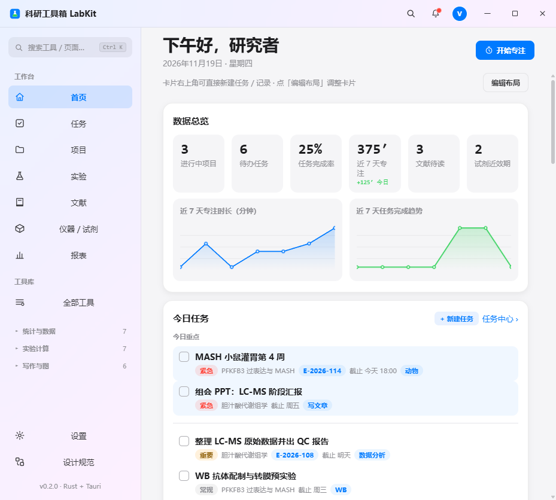

<div align="center">


# 科研工具箱 LabKit

**本地优先的科研工作台 · Local-first research toolbox**

台账工作台 · 20 个科研工具 · SDPC 全切片浏览与 ROI 裁剪 · qPCR ΔΔCt 分析

[](https://github.com/Funvvell/pathology-crop-tool/releases)
[](LICENSE)
[](#-快速开始)
[](https://funvvell.github.io/pathology-crop-tool/)

[快速开始](#-快速开始) · [功能特性](#-功能特性) · [快捷键](#-快捷键) · [开发指南](#-开发指南) · [English](README.en.md)

</div>

> **免责声明**：本软件全部计算与图像结果**仅供科研使用，不用于临床诊断**。
> **隐私**：全部本地计算，无遥测、无账号、无上传；台账只存在你自己的电脑上。



---

## ✨ 功能特性

### 工作台（科研台账）

- **任务 / 项目 / 实验 / 文献 / 仪器 / 试剂 / 预约 / 经费 / 速记 / 提醒** 十一类记录，看板 + 表格双视图
- **可编辑 Dashboard**：卡片自由增删拖拽（gridstack 思路），布局随台账保存
- **专注计时**与近 7 天趋势、任务完成率报表
- **通知中心**：任务截止、试剂效期、仪器校准到期、导出完成等汇总提醒（标题栏铃铛）
- 数据磁盘化：`~/.liver_portal_crop/labkit_db.json`，原子写 + 滚动备份 + 损坏自愈；浏览器模式降级 localStorage

### 工具库（20 个工具 / 工作区）

| 分组 | 工具 |
| --- | --- |
| 统计与数据 | 2×2 表分析（OpenEpi）· 样本量与功效（OpenEpi）· 快速假设检验（t/χ²/Fisher/MWU/Wilcoxon/方差齐性/相关）· Table 1 基线表 · 随机化与盲法 · 数据清洗与交叉表 · APA7 统计报告串 |
| 实验计算 | 实验计算器（配液/离心/铺板/MOI）· 引物工作台（NN 热力学 Tm）· **qPCR 分析工作区**（ΔΔCt/Pfaffl/geNorm）· 孔板布局编辑器 · Protocol 计时器 · 实验记录→Markdown · 试剂/仪器台账 |
| 写作与图 | 数据绘图器（期刊预设 300/600dpi）· Figure 拼图器 · 图片批处理（Rust 并行）· **图像裁剪工作区**（SDPC WSI + ROI + TIFF）· 报告规范清单（PRISMA/STROBE/CONSORT/MIQE）· 表格格式互转 |

每个工具统一壳层：**载入示例 / 重置 / 帮助与来源抽屉 / 导出条**；输入与配置**自动持久化**（切页、重启不丢）；
**跨工具数据流**：数据清洗 → 检验 / 绘图 / Table 1，检验结果 → APA 报告串（跨重启可载入）。

### 交互（参照 IT-Tools / DevToys / Rubick 的成熟范式）

- **Ctrl+K 命令面板**：20 工具 + 全部页面 + 全局动作，支持**拼音首字母**模糊匹配（如 `yw`→引物、`sjqx`→数据清洗）
- **持久侧栏**：工作台 / 工具库分组 / 收藏 / 设置，任何页面一键可达（首页卡片删光也不失联）
- **hash 路由深链**：`#/tool/tests` 可分享、刷新恢复、前进后退可用
- **收藏与最近使用**、全局快捷键注册表 + `?` 帮助浮层
- **暗色模式**（浅色 / 深色 / 跟随系统）；图表与裁图画布保持纸面白色，符合期刊投稿要求
- 首启欢迎：空白开始 / 载入示例二选一；称呼可自定义

### 病理图像工作区

- SDPC 全切片金字塔浏览（LRU tile 缓存、导航缩略图、滚轮切层），支持 120,000×80,000+ px 切片
- ROI 框选 / 组织检测辅助 / 全分辨率 TIFF 批量导出（DPI 标签保留）
- 普通图片（png/jpg/tif）裁剪**无需**任何额外组件

## 🚀 快速开始

### 方式一：下载安装包（推荐）

[Releases](https://github.com/Funvvell/pathology-crop-tool/releases) 下载 `LabKit_*.exe`（NSIS 安装包）或 `LabKit-portable-win-x64.zip`（免安装）。

**SDPC 解码组件（可选）**：出于许可考虑，安装包**不含**厂商闭源 `DecodeSdpcDll.dll`。
需要浏览 `.sdpc` 切片时执行：

```bash
pip install sdpc-for-python
```

应用会自动探测解码目录（随包目录 → `SDPC_DLL_DIR` 环境变量 → Python site-packages）。
缺失时裁剪页会显示获取指引；其余 19 个工具与台账功能不受影响。

### 方式二：Web 演示（零安装）

<https://funvvell.github.io/pathology-crop-tool/> —— 浏览器降级模式：台账存 localStorage，
统计/绘图/写作类工具完整可用；SDPC 解码与磁盘备份需桌面版。

### 方式三：源码运行

```bash
git clone https://github.com/Funvvell/pathology-crop-tool.git
cd pathology-crop-tool/rust
cargo install tauri-cli --locked   # 首次
cargo tauri dev                    # 开发运行
cargo tauri build                  # 出安装包
```

前端**零构建**：`frontend/` 为原生 HTML/CSS/JS（classic script 顺序加载），
直接用浏览器打开 `frontend/index.html` 即可演示，无需 Node/Vite。

## ⌨️ 快捷键

| 按键 | 作用 |
| --- | --- |
| `Ctrl+K` | 命令面板（工具 / 页面 / 动作，拼音首字母可搜） |
| `Ctrl+,` | 设置 |
| `Alt+←` / `Alt+→` | 后退 / 前进 |
| `?` | 快捷键帮助浮层 |
| `Esc` | 关闭面板 / 抽屉 |
| 裁剪工作区 | 滚轮缩放、拖拽平移、ROI 手柄调整（见 `?` 浮层视图段） |

## 🔒 数据与隐私

- 台账：`~/.liver_portal_crop/labkit_db.json`（设置页可查看路径 / 备份 / 导入导出 / 重置）
- 工具输入快照、收藏、最近使用、主题与称呼同随台账落盘
- **无遥测、无网络请求**（除你主动打开的文献 DOI 链接与可选 InvenTree API 对接）
- 浏览器演示模式数据仅存本机 localStorage

## 🧱 架构

```
frontend/            零构建前端（index.html 壳 + css/ + js/ 模块 + tools/ 20 工具 + vendor/ 开源库）
rust/                Tauri 2 + Rust：SDPC FFI 解码、TIFF 导出、qPCR 解析、台账磁盘化、77+ 单测
tests/js/            node:test 对数测试（统计口径与 OpenEpi/scipy/tableone 对齐）+ 外壳单测
rust/tests/          IPC 命名契约测试（保护前后端接口）
liver_portal_crop/   Legacy Python/PySide6 实现（算法参照，见下）
```

- Rust 算法层与 IPC 契约稳定，前端交互迭代不触碰（契约测试保护）
- 统计实现均与上游对数：`tests/js/stats.test.mjs` 等 93 个 node 用例 + 96 个 cargo 用例

## 🛠️ 开发指南

```bash
# Rust 全量测试
cd rust && cargo test
# 前端对数 / 外壳测试（Node 18+）
node --test tests/js/*.test.mjs
```

新增一个工具只需三步（注册表条目 + 脚本 + 对数测试），详见 [CONTRIBUTING.md](CONTRIBUTING.md)。
交互范式参考 [IT-Tools](https://github.com/CorentinTh/it-tools)、[DevToys](https://github.com/DevToys-app/DevToys)、[Rubick](https://github.com/rubickCenter/rubick)（仅借鉴交互，未复制其代码）；病理工作区以 [QuPath](https://github.com/qupath/qupath) 为领域基准。

## 📦 Legacy Python 版

根目录 `liver_portal_crop/`（PySide6）是功能等价的旧实现，**仅作算法参照与备用版本保留**，
不再随 tag 发布；如确需旧版 exe 可手动触发 `Legacy Python Build` 工作流。
桌面版请以 `rust/` 的 LabKit 为准。

## 📄 许可与署名

- 本项目 [MIT](LICENSE)
- 第三方组件署名见 [NOTICE.md](NOTICE.md) 与 [frontend/vendor/LICENSES.md](frontend/vendor/LICENSES.md)
  （OpenEpi MIT、stdlib-js Apache-2.0、SciPy/Biopython BSD-3、Plotly/fabric MIT 等）
- PRISMA 2020 清单 CC-BY 4.0；SDPC 解码 DLL 为厂商专有二进制，**不在本仓库与安装包中再分发**
- 社区：[贡献指引](CONTRIBUTING.md) · [安全策略](SECURITY.md) · [行为准则](CODE_OF_CONDUCT.md) · [更新日志](CHANGELOG.md)

> **仅供科研使用，不用于临床诊断。** Research use only; not for clinical diagnostic use.